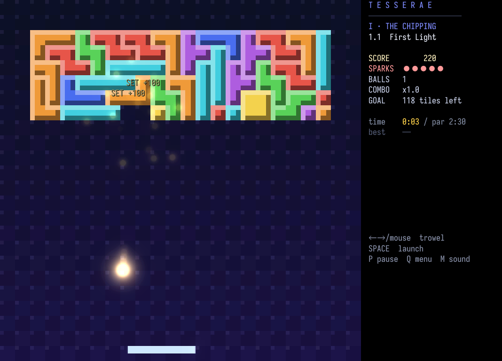
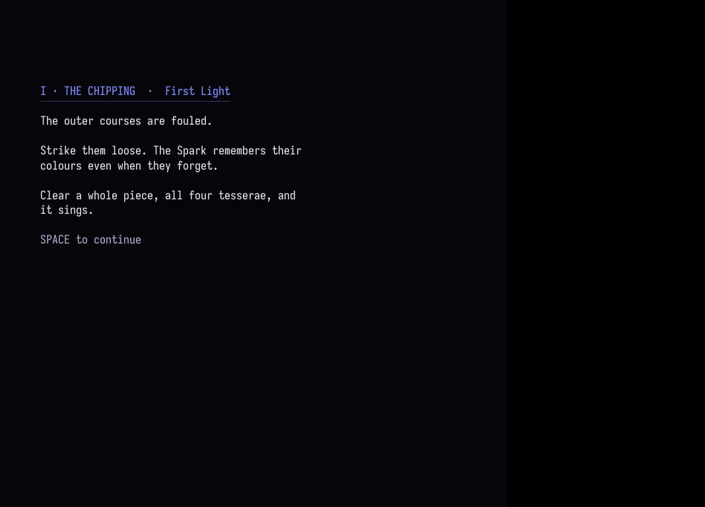
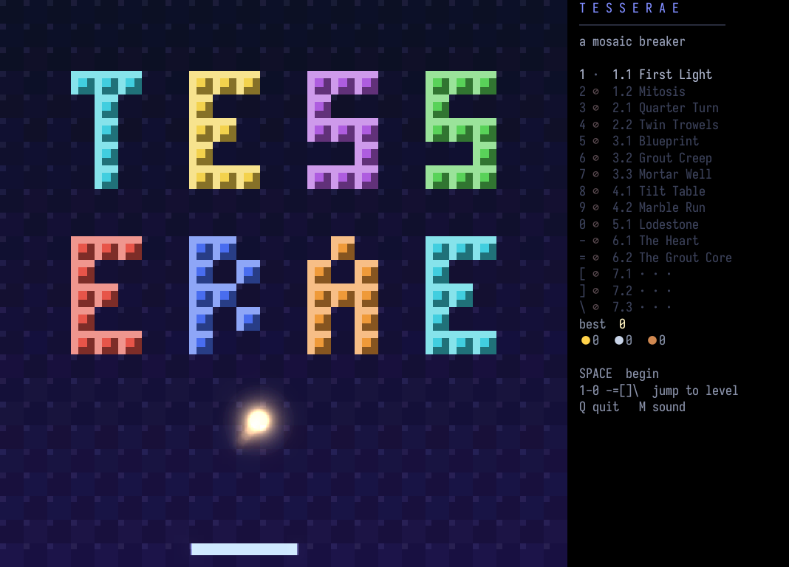
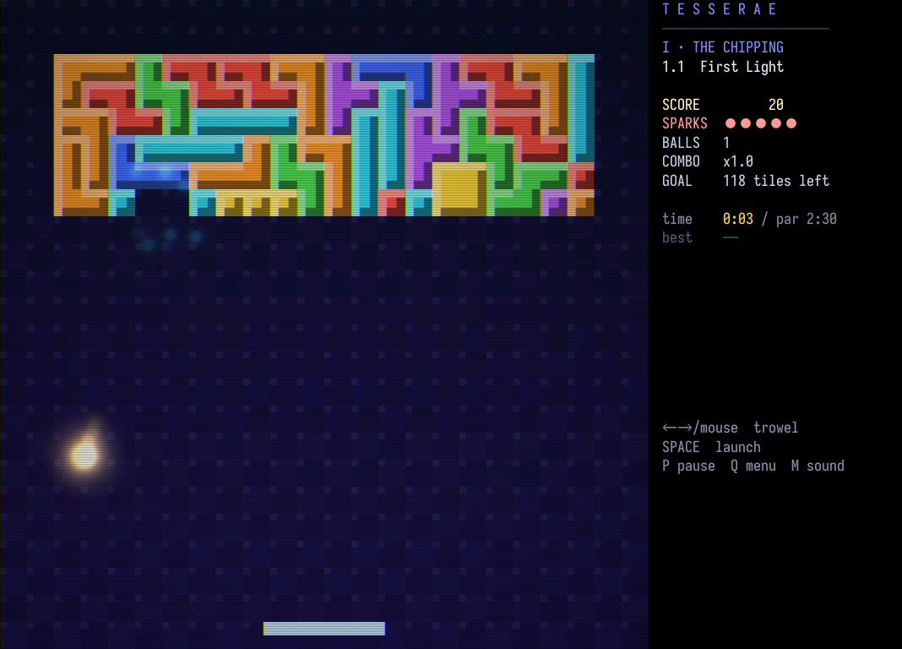

# pix-host: TESSERAE in an Ebitengine window

A spike on `wt/ebiten-spike` asking whether the game looks better as real
pixels with shaders, without touching its simulation. The game itself is
unchanged except at the seams below; on a stock `lg` every seam resolves to nil
and the terminal build runs as before (`just test` passes on both).



## Running it

```sh
go -C pix-host build -o lg .
LG=pix-host/lg ./play.sh --level 1        # --pix-k 4|8|12 sets arena px per world unit (8)
```

The window takes the keys and mouse once it has focus; the terminal still works
too. Effects are host keys the game never sees:

| key | effect | starts |
|-----|--------|--------|
| F1 | bloom strength: off, 0.5, 1.0, 1.6 | 0.5 |
| F2 | posterize the light (off: the raw sum, clamped) | on |
| F3 | CRT: scanline per arena row, RGB split, vignette | off |

On a Mac keyboard the F-keys may need `fn`.

## How it fits together

`pix-host` is `audio-host` (stock `lg` CLI plus undertone's `audio`) with a
`pix` namespace. Ebitengine has to own the main thread, so `lg` runs `cli.Main`
on a goroutine and `main` waits for either `lg` to exit or a window request.

The game reaches the host at five seams, each resolved at load time:

- `gfx/compose!` hands the screen's buffers to `pix/present-arena!`, which does
  the per-pixel work in Go: overlay, else the cached static layer through the
  field's rotation, plus the light, posterized. That moves roughly 4 ms of lg
  per frame (at k=4) into Go (the measurements below).
- `gfx/text!` sends whole strings to `pix/text!`; the host draws them as type
  where their cells were, stacking any that would overlap.
- `panel-line!`/`panel-segs!` send changed rows to `pix/panel!`, drawn beside
  the arena.
- `draw-card!` sends the card's typed-so-far lines to `pix/card!`.
- `input/poll!` drains `pix/events`: key presses with real releases (held like
  kitty's), left clicks, and the cursor as a world x.

Bloom is built from the frame's light alone (the `acc-*` buffers), so only what
is lit glows: half- and quarter-size copies, each Kage-Gaussian-blurred both
ways, added back over the scaled arena.

## Measurements

MacBook Air, level 1.1, as of 2026-10-28; median / p95.

| k | Go compose | lg frame |
|---|-----------|----------|
| 4 | 0.20 / 0.23 ms | 20.4 / 21.2 ms |
| 8 | 0.86 / 0.92 ms | 20.1 / 21.8 ms |
| 12 | 2.24 / 3.25 ms | 20.1 / 31.2 ms |

Those are autopilot runs before text and effects. With text, panel and bloom at
k=8 (hand-launched, 995 frames): compose 0.77 / 0.90 ms, frame 20.1 / 21.1 ms,
and frame time was the same with bloom off, at 1.6, or with CRT on. The k=12
p95 comes from lg drawing light into 2.25× the pixels, not from the host.

## Headless checks

No screen capture needed:

- `PIX_SNAPSHOT=out.png PIX_SNAPSHOT_AT=<tick>` saves the window as drawn.
- `PIX_INJECT="150:space:press,151:space:release,200:mouse-wx:30"` types into
  the window by Update tick.
- `PIX_FX="bloom=1,post=0,crt=1"` presets effects.
- `PIX_STATS=file` writes the timings above.

Run under a pty (`script -q log ./play.sh ... </dev/null`).

| card | title | CRT |
|------|-------|-----|
|  |  |  |

## Known gaps

- Type is drawn over the effects, so the CRT pass doesn't reach text.
- Two floats spawned together stack a line apart, rather than the later
  overwriting the earlier as in the terminal.
- Desktop only; the browser build is untouched. Ebitengine's wasm port would be
  the route there, with its own main-loop question.
- Sprites: the arena is still the game's raster. Real sprites would be the next
  seam, with the tile, trowel and spark drawing (`gfx/shape-disc!`, `gfx/rect!`
  and the static layer) handing shapes to the host as textured quads.
